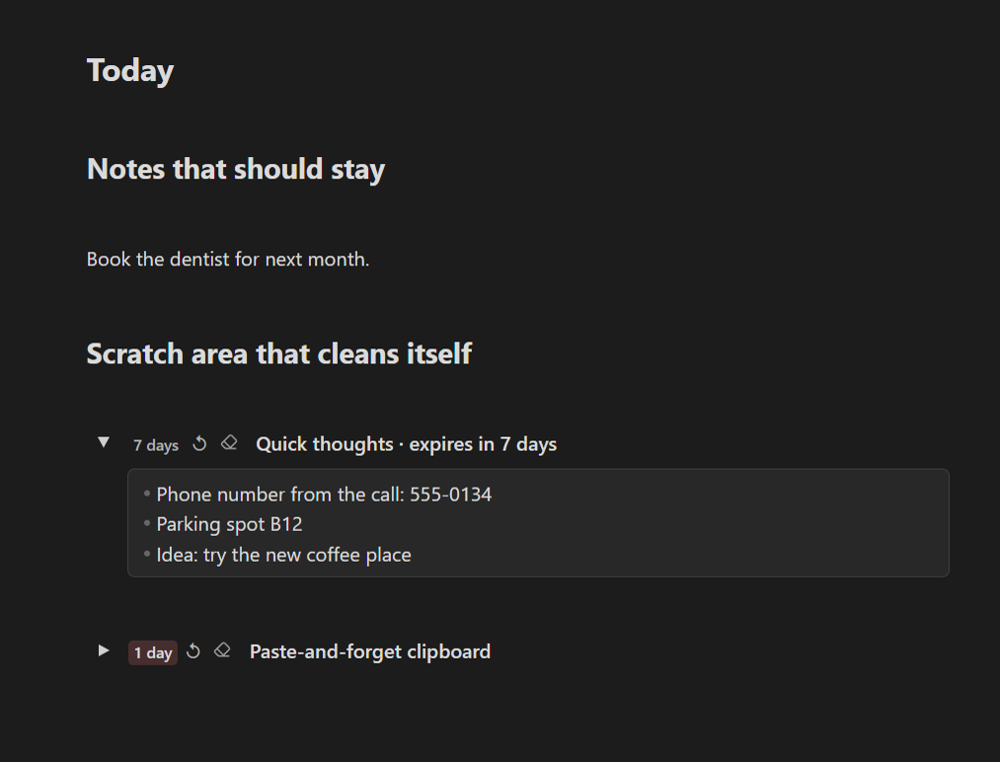

# Expiring Blocks

**A scratch area inside your note that cleans itself up.** Jot things down, and if you stop touching them, they disappear after the number of days you choose.



## Is this for you?

- Your daily note is full of phone numbers, parking spots, links and half-thoughts that mattered for one afternoon.
- You keep a "temp" heading that never actually gets emptied.
- You want a place to paste things **without** having to remember to delete them later.
- You like the idea of a to-do inbox that quietly forgets what you clearly did not need.

## How it works

1. Run **Create expiring block** from the command palette (or the editor's right-click menu).
2. Give it a title and write or paste anything inside.
3. The badge shows how many days are left, e.g. **7 days**.
4. **Editing the contents renews it.** Leave it alone and, once the time is up, the contents are cleared. The title stays, ready for the next round.

Buttons next to the badge:

- ↻ renew now, without editing
- ⌫ clear it immediately

Set the default lifetime in **Settings → Expiring Blocks → Lifetime (days)**.

## Plain Markdown

An expiring block is a toggle list with a little extra metadata in an invisible comment:

```markdown
Quick thoughts %% nsb-toggle {"id":"tgl-scratch","open":true,"v":2,"expiry":{"v":1,"updatedAt":1793819721971,"days":7}} %%
- Parking spot B12
%% /nsb-toggle %%
```

Without the plugin it is still readable text, and nothing is ever deleted.

## Works on

Windows, macOS, Linux, iPhone / iPad and Android. Expiry is based on the date saved in the note, so every synced device agrees on when a block is due.

## With or without Editor Enhancer

Expiring Blocks ships its own toggle engine, so it works on its own. Install [Editor Enhancer](https://github.com/Paipa03/obsidian-editor-enhancer) as well and expiring blocks also get Notion-style drag handles, like every other block.

## Good to know

- Expired contents are **deleted from the note**. Anything you want to keep belongs outside an expiring block, or should simply be edited once in a while.
- To find blocks that are due, the plugin looks through your Markdown notes when Obsidian starts and every two hours while it is open. It only changes notes that contain an expired block. Nothing leaves your device.
- Interface in English and Chinese: follows Obsidian's language by default, or pick one under the plugin's **Language** setting.

## Install

**Settings → Community plugins → Browse**, search **Expiring Blocks**, then Install and Enable.

## License

MIT
